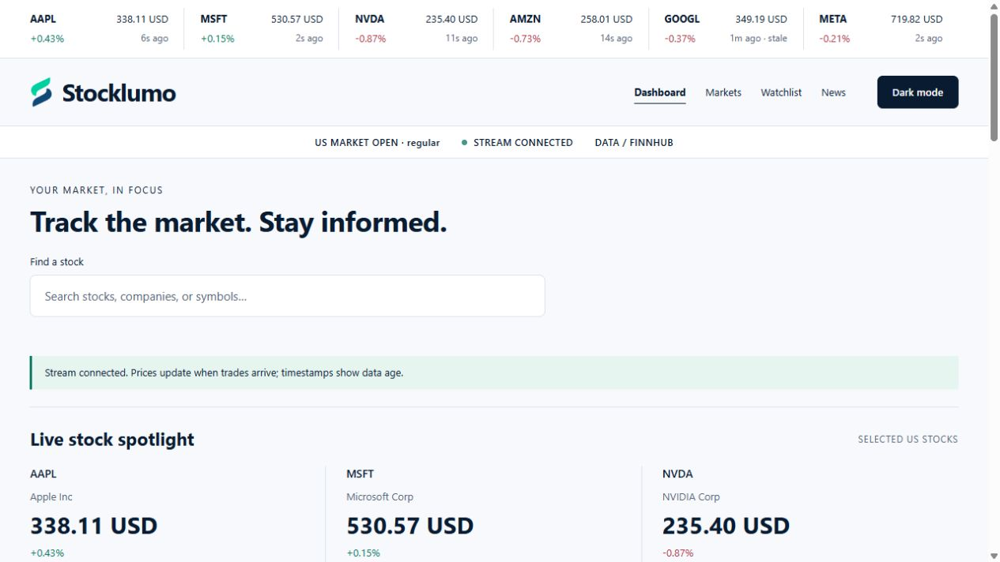

# Stocklumo

Stocklumo is an ASP.NET Core 10 MVC stock-tracking application powered by Finnhub. It combines an editorial financial interface with live prices, company pages, a browser-local watchlist and source-linked news.



Captured from the running application on 8 October 2026. Prices in the screenshot are historical observations, not current quotes.

## Features

- Dashboard, Markets, Watchlist and News routes, plus `/stock/AAPL` style company pages.
- Fixed eight-stock ticker (AAPL, MSFT, AMZN, GOOGL, META, TSLA, V, NVDA) on every page, separate from the daily provider-selected spotlight, with timestamps and shared subscriptions. Twelve exploration links expand to twenty-four. The connection pulse respects reduced-motion settings.
- Debounced company/symbol lookup with cancellation and keyboard-accessible results.
- Quote prices, previous-close changes, available daily statistics and company profiles.
- Shared server-side WebSocket feed with subscription reference counts, unsubscribe, idle disconnect, reconnection, bounded messages and shutdown cancellation.
- Server-sent events deliver price snapshots to browsers once a second without exposing credentials. Multiple ticks may be coalesced.
- A 20-stock watchlist with add/remove/move-up controls and eight recently viewed stocks, saved in this browser.
- Interactive session chart, pointer and keyboard inspection, and plan-dependent historical ranges. Historical controls appear only when the provider returns candle data.
- Market status, live stock spotlight and news with explicit setup, unavailable and error states.
- Light and dark themes, responsive layouts, semantic controls, visible focus, and signed price changes.
- A ribbon-style SVG mark based on the supplied brand reference, local assets and no frontend runtime framework or CDN dependencies.

## Data limitations

Authenticated local verification on 8 October 2026 confirmed Finnhub company search, AAPL/MSFT quotes and live trades, company profiles, basic metrics, news and US market status. Two browser clients shared one upstream connection; closing all site tabs released it. The API key is stored outside the repository in ASP.NET User Secrets and was checked against served pages, assets and source files for accidental exposure.

The tested account returned unavailable responses for historical candles and the three index quotes. The dashboard uses a daily selection of provider-listed common stocks, clearly labeled as a selection rather than an index or ranking. Historical charts retain their unavailable state; the live session chart remains available. Account entitlements and provider availability can change. Render Free hosting was deployed and verified on 9 October 2026. An external penetration test has not been completed.

Local verification passed 48 backend tests and ten frontend tests. The Release publish command also succeeded. Browser checks covered keyboard search and chart inspection, watchlist persistence/reordering, dark/light themes, mobile/tablet/desktop layouts, idle feed cleanup, and connection-loss/recovery during a server restart. Dependency checks reported no known vulnerabilities at the time of review. This does not establish that every failure mode or deployment environment has been tested.

The app never substitutes invented prices, news or company profiles. Starter company names are navigation labels, not price data or a trending ranking. Historical endpoints may not be supported by your Finnhub plan. Unavailable data stays unavailable; ETFs are not silently substituted for indices. Session history contains only observations received while the page is open and resets on reload. News excerpts come from Finnhub and link to their original publisher. Company description and volume are omitted when the selected endpoints do not provide them.

## Stack and structure

C#, ASP.NET Core 10 MVC, Razor, HTML, CSS, plain JavaScript, xUnit and ASP.NET Core TestHost. Node and jsdom are used **only for frontend tests**, not to run the website.

- `MarketDesk/Program.cs` registers services and configures middleware, security headers, HTTPS and rate limits.
- `MarketDesk/Controllers/MarketController.cs` serves pages and the browser event stream.
- `MarketDesk/Controllers/DataController.cs` validates public requests and constructs fixed Finnhub endpoint paths.
- `MarketDesk/Services/FinnhubApi.cs` owns the shared REST cache, request budget, credential handling and safe provider errors.
- `MarketDesk/Services/FinnhubFeed.cs` manages the one upstream WebSocket and cached quote refreshes.
- `MarketDesk/Services/MarketStore.cs` synchronizes price state and counts browser subscriptions.
- `MarketDesk/Models` defines immutable price records and stock-symbol validation.
- `MarketDesk/Views/Market/Index.cshtml` and `MarketDesk/wwwroot` provide the interface.
- `MarketDesk.Tests` covers server and HTTP behavior; `tests` covers frontend behavior using clearly synthetic fixtures.

The solution retains the existing `MarketDesk` project names to preserve the original app and User Secrets identity. Public branding is Stocklumo.

The provided course notes and cheat sheet guided the MVC/Razor, DI, middleware, configuration, HTTP integration, validation, logging and testing approach. A database, identity system and repository layer are not needed for this account-free, read-only market monitor. WebSocket streaming and server-sent events extend the course's HTTP integration foundation.

## Local setup

Install the .NET 10 SDK. Open `MarketDesk.slnx` in a compatible Visual Studio with the ASP.NET workload, or run from this repository:

```powershell
dotnet user-secrets set "Finnhub:ApiKey" "YOUR_FINNHUB_KEY" --project MarketDesk
dotnet dev-certs https --trust
dotnet run --project MarketDesk
```

Open https://localhost:7143. The Development launch profile also serves http://localhost:5143 and loads User Secrets. Restart after changing the key. Without a key, the app starts in setup mode.

Get a key from https://finnhub.io/. Never paste the real key into Git, JavaScript, HTML or screenshots. User Secrets are a local convenience, not an encrypted production vault. The `UserSecretsId` remains `marketdesk-finnhub-local`, preserving the previous project setup.

## Run tests

```powershell
dotnet test MarketDesk.slnx -c Release
npm ci --ignore-scripts
npm test
dotnet list MarketDesk.slnx package --vulnerable --include-transitive
npm audit
```

Backend tests cover price ordering, nullable calculations, payload parsing, subscription cleanup and capacity, symbol validation, shared caching, credential isolation, 401/403/429 handling, rate limits, SSE delivery, page routing, invalid requests, HTTPS/HSTS and response headers. Frontend tests cover supplied quote/profile rendering, local persistence, theme selection, news escaping, unsafe links, chart inspection, delayed quotes, unverified saved symbols and missing-key states.

## Live verification after configuration

1. Stop other Stocklumo instances sharing this key. Start the configured app and search for a company such as Apple.
2. Open a result; compare its quote, timestamp, currency and exchange with the provider response. A current connection alone does not establish a fresh price.
3. During that stock's trading session, verify incoming trades change the displayed price without a reload. Open two tabs and confirm only one upstream WebSocket is used.
4. Add, remove and reorder watchlist entries; reload and navigate back through recently viewed stocks.
5. Close the tabs and verify subscriptions are released and the idle upstream connection closes. Reopen a stock and verify reconnection.
6. Verify candle, news, market-status and spotlight access for your actual plan. Check unavailable states for endpoints outside the plan.
7. Interrupt network access and restore it; verify stale labels, backoff and recovery. Confirm the API key is absent from browser requests, HTML and logs.

## Security review and boundaries

- All user-facing endpoints are read-only. Watchlists and theme changes happen in localStorage, not authenticated server mutations. No authentication cookies or database exist, so cookie flags, SQL injection and authenticated CSRF do not apply to this version.
- Symbols are length-limited and allowlisted. Search text is bounded and URL-encoded. Provider URLs are constructed on the server; clients cannot choose an upstream host. Automatic redirects are disabled. Only the stock-symbol endpoint may follow one HTTPS redirect to static2.finnhub.io:443, without forwarding the API key.
- CSP allows only local scripts/styles/connections/images and forbids framing and base URLs. Dynamic values use Razor encoding or DOM textContent. Publisher/company URLs require HTTP(S) without embedded credentials; external links use noopener/noreferrer.
- The key is sent in the REST authentication header. Finnhub requires the key in its WebSocket URL; exception messages and HTTP-client request logs are not emitted. Avoid enabling URI tracing in production.
- Provider errors return safe messages. A 429 creates a 60-300 second shared cooldown; unauthorized access also backs off. No provider error body is sent to users.
- REST usage is capped at 45 uncached requests per minute per process. Requests are serialized and identical requests share cached results. Cache accounting is bounded to approximately 16 MiB of payload/key text; response bodies are capped at 2 MiB and WebSocket messages at 256 KiB.
- At most 40 distinct live symbols and 100 browser event streams are active per process. Each browser requests at most 37 symbols: twenty watchlist entries, the selected stock, eight spotlight stocks and eight fixed ticker stocks. Stored server stock entries are bounded to 256. These controls limit resources; they do not replace edge-level abuse protection.
- Quotes and news retain timestamps. Live-feed status and market-open status are distinct. Network silence marks the connection disconnected, and old price timestamps are labeled stale.
- Production uses HTTPS redirection, HSTS, host filtering, safe exception responses and no permissive CORS policy. HTTPS port defaults to 443.

This is a code-level review and automated verification, not a penetration-test certificate or a guarantee of permanent security. Keep dependencies and the runtime patched and assess the actual deployment.

## Deployment

```powershell
dotnet publish MarketDesk -c Release -o publish
```

Run the published app with a supported .NET 10 ASP.NET Core runtime. Configure:

- `ASPNETCORE_ENVIRONMENT=Production`
- `Finnhub__ApiKey` through your hosting secret store.
- `AllowedHosts` as your exact public hostname; the checked-in default permits local hosts only.
- Valid TLS at Kestrel or your reverse proxy.

With a TLS-terminating proxy, configure ASP.NET Core Forwarded Headers with **explicitly trusted proxy addresses** before HTTPS redirection. Do not accept arbitrary forwarded headers. Configure the proxy to pass through `/api/market/stream` without buffering or caching and allow long-lived responses. Outbound HTTPS and WebSockets to Finnhub must be permitted. Ensure monitoring does not log secret-bearing URLs.

Run one app instance per Finnhub key. Finnhub documents one WebSocket connection per key; scaling to multiple instances requires a separate feed service and shared distribution. Confirm your plan and intended redistribution rights before public launch. Public HTTPS routes, security headers, provider quotes and the event stream were verified on Render Free on 9 October 2026.

## Branding and references

The Stocklumo ribbon mark was redrawn as SVG from the user-provided brand reference, with navy/mint light and dark variants. Initial exact-name web searches found no matching use on 8 October 2026; trademark, domain and social-handle clearance have not been established.

- https://finnhub.io/docs/api
- https://finnhub.io/docs/api/websocket-trades
- https://github.com/Finnhub-Stock-API/finnhub-go/blob/master/api/openapi.yaml
- https://www.udemy.com/course/asp-net-core-true-ultimate-guide-real-project/


## Final local review - 9 October 2026

48 backend tests and 10 frontend tests pass. The dependency scans reported no known vulnerabilities. Malformed company profile payloads now return an unavailable result instead of causing a server error. The source package excludes credentials, dependency caches, build output, temporary files and Git metadata. This is a local code review, not an independent penetration test. Published at https://stocklumo.onrender.com from the private https://github.com/omarhussainfahmi/stocklumo repository. GitHub verification passed. Public routes, health, assets, HTTPS security headers, real provider quotes and connected SSE responses passed deployment checks. Quote changes during an open trading session were not observed in this deployment check; the provider reported pre-market and older quotes were correctly labeled stale.

Cloudflare Containers can host the ASP.NET Core application; static Pages uploads cannot run its server. Containers require the Workers Paid plan and usage charges (https://developers.cloudflare.com/containers/platform/pricing/). Do not upload the source ZIP as a static website.


## Render Free

The root Dockerfile builds the .NET 10 application and runs it as an unprivileged user on port 10000. The Docker context excludes local secrets, build output and development dependencies. `render.yaml` selects the Free web-service plan with `/health` as a process health check, independent of Finnhub availability.

Connect this repository to Render, select Docker and the Free instance, and configure `Finnhub__ApiKey` as a secret environment variable. Do not add payment details or select paid add-ons. Render supplies `RENDER=true` and `RENDER_EXTERNAL_HOSTNAME`. Only in Production on Render, the app accepts that exact hostname and uses Render's documented HTTPS-only public edge; it does not trust client-supplied forwarded headers. Custom domains require updating the explicit host policy before use. Other hosting environments retain HTTPS redirection.

Run one instance, and stop local live-feed sessions using the same Finnhub key before production verification. Free services sleep after 15 minutes without inbound traffic and may take about one minute to wake. Monthly usage limits and external traffic restrictions apply. This is portfolio hosting without an uptime guarantee. See https://render.com/docs/free and https://render.com/docs/tls.


## Research expansion - 11 October 2026

The existing MVC/Razor architecture, shared Finnhub request budget, streaming feed and branding remain in place. Currently available navigation exposes:

1. `/screener`: filter 12 explicitly selected US companies by name/ticker, minimum price, day percentage change, Finnhub industry, market cap and 10-day average volume; sort, reset and save/load one local preset. This is not a full-exchange screener. Missing metrics fail numeric filters. Market cap is USD millions; average volume is millions of shares, not current-day volume. Only USD quotes enter the price-filter universe.
2. `/compare`: compare 2-5 symbols with currency-labeled prices, TTM P/E and dividend yield, and USD market cap. Historical charts intersect common timestamps across all selected stocks and normalize each series to 100 on the first common date. They measure local-currency price performance, not total return or FX-adjusted performance.
3. `/portfolio`: add/edit/remove up to 20 hypothetical lots across 10 symbols, with quantity, purchase price and purchase date. Cost basis, value, unrealized P/L and allocation are grouped by currency. Missing or pre-purchase quotes suppress complete totals. Holdings stay in localStorage, not Render's ephemeral disk; clearing browser data removes them. Valuations refresh every 60 seconds while visible. Historical P/L requires common daily prices after all purchase dates within one year and assumes continuous holdings; fees, dividends, corporate actions and currency conversions are excluded. No brokerage or trade execution exists.
4. `/earnings`: upcoming calendar with ticker/watchlist filters and latest four reported quarters per selected ticker or watchlist. Announcement date and fiscal period are separate concepts. Estimates, actuals and missing fields are labeled. Earnings endpoints do not identify currency, so values are not summed or treated as comparable across companies.
5. Ticker/spotlight recovery: retry failed initial profiles after a minute, reconnect a stream whose heartbeat stops (bounded to once a minute), and reconnect on browser network recovery. Closed-market quotes show elapsed age and a market-closed explanation. No timer manufactures price changes.

### Provider verification and limits

Authenticated checks on 11 October 2026 returned HTTP 200 for `quote`, `stock/profile2`, `stock/metric`, `calendar/earnings`, `stock/earnings` and `stock/market-status`. `stock/candle` returned HTTP 403 with the current key. Consequently normalized history and historical portfolio P/L cannot display real historical results on this subscription. Implementations are tested using explicit synthetic test fixtures; the production interface instead explains the missing access. Upgrading provider access is not required or purchased. No alternate or invented data source is used.

The provider reported the US market closed during verification; quotes retained Friday 9 October timestamps. Live SSE connectivity is separate from the existence of new trades. A continuously connected stream does not guarantee continuously changing prices. Changes during an open trading session cannot be verified on a Sunday.

`ResearchService` safely extracts typed profile/quote/metric fields through the existing `FinnhubApi` cache. `ResearchController` validates symbols and bounds earnings dates to 92 days within a year of today. Research routes share the existing global request limits; busy sessions may show incomplete data with a retry action. `research-math.js` contains pure, tested browser-local calculations; `research.js` handles the feature controls and safe DOM rendering. No new runtime dependency or database is required.

### Verification and deployment

Run `dotnet test MarketDesk.slnx -c Release`, `npm test`, and `dotnet format MarketDesk.slnx --verify-no-changes --no-restore`. Browser checks cover desktop/mobile layouts, real screener and comparison values, hypothetical holding persistence/removal, restricted historical data and actual earnings responses. Existing watchlist, chart and news behavior retains regression coverage. These checks are not an independent penetration test.

Keep `Finnhub__ApiKey` in Render's secret environment variables. Push the tested source to the connected `main` branch; Render builds the existing Dockerfile on the Free plan. Verify `/health`, all four available research page routes, research API responses and SSE after Render reports a successful deployment. Stop local instances using the same key before production verification because Finnhub allows only one upstream stream per key. No migration, scheduled background job or paid storage is needed.

The free address remains https://stocklumo.onrender.com. A custom `www.stocklumo.com` address requires domain ownership and DNS configuration; no domain was purchased, as requested.

Deployment verification completed on 11 October 2026: commit 4d49e80 is Live on Render Free and GitHub workflow 38145691526 passed. All 60 backend and 25 frontend tests pass. Formatting, npm audit and .NET dependency scans passed. Public health, five new routes, research and earnings APIs, security headers and credential-isolation checks passed. The published screener loaded all 12 companies, and SSE delivered advancing heartbeats with genuine Friday quote timestamps during the closed Sunday market.


## Live-data diagnosis (12 October 2026)

At 11:27 UTC (07:27 New York), the production quote endpoint returned AAPL
336.64 with provider timestamp 2026-10-09 20:00:00 UTC. Finnhub market status
reported `isOpen=false`, `session=pre-market`. An eight-second production SSE
sample delivered eight changing server heartbeats with the same quote timestamp.
A direct browser load reproduced this; its console had no errors. Render logs
showed successful startup and no feed errors in the inspected period. No local
MarketDesk process was running during the initial investigation.

Confirmed defects: upstream handshake success drove the green connected indicator
without a received trade; quote-refresh failures were discarded; malformed trade
entries could abort a complete batch; replaced EventSource callbacks could still
write to current state. The observed old quote is provider data from Friday's close,
not a timestamp conversion error. These findings do not prove an open-market outage.
Google returned no Stocklumo result for the exact hostname during this check, so a
real indexed search-result click could not be tested. No service worker or
referrer-dependent initialization exists in the source.

Connection health remains `status` in `/api/market` and SSE. `lastProviderMessageAt`
records an actual upstream JSON message (including pings); `subscriptionCount`
counts successfully sent subscriptions, not provider acknowledgments. Per-stock
`tradeReceivedAt` records receipt of an accepted trade; `updatedAt` always remains
the provider's price timestamp. `quoteState` reports REST failures without erasing
the last good price. No credentials or raw provider error bodies are included.

The browser separates CONNECTING, LIVE, MARKET CLOSED, STALE, DISCONNECTED and
ERROR. LIVE requires an accepted US-exchange trade with both provider and receipt
age within 120 seconds, an active connection, and a current open-market status.
This is a conservative application observation window, not a Finnhub latency or
full-exchange coverage guarantee. REST observations use a 180-second stale window,
allowing for the shared 60-second cache and polling cycle; they do not alone earn
LIVE. Closed regular sessions are explained separately. Thinly traded stocks can
be stale without a transport failure. Unknown exchange calendars/entitlements are
not inferred from a company's headquarters. Delayed coverage is not assigned an
invented delay duration. Market-status checks expire after two minutes and reject
provider status timestamps older than three minutes. Absolute price date/time and
UTC are displayed; future values beyond one minute are rejected.

Keep one application instance per Finnhub key: Finnhub documents a single upstream
WebSocket connection per key. Do not run a credentialed local instance alongside
Render. Reconnects retain bounded exponential backoff and rebuild the subscription
set; browser recovery ignores callbacks from old connections and resumes after
visibility changes. HTML and data requests use no-store; static bundles remain
content-versioned. Render Free cold starts remain possible and are not disguised
as fresh data.

Verification commands: `dotnet test -c Release`, `npm test`,
`dotnet format --verify-no-changes --no-restore`, and `git diff --check`.
The repair regression run passed 67 backend and 29 frontend tests, including existing
research features. Real open-session trade advancement still requires observation
while Finnhub supplies trades; synthetic fixtures are used only in automated tests.

References: [Finnhub streaming contract](https://finnhub.io/docs/api/websocket-trades),
[NYSE hours and holiday calendar](https://www.nyse.com/trade/hours-calendars).


Production verification: Render deployed `012a0735afaef671b79c8d6d53adb8ab82a0e3d4`
on 12 October 2026; GitHub Actions run `38244119752` passed. A subsequent 40-second
SSE capture (11:41:11-11:41:50 UTC) contained 40 frames and six active subscriptions.
It included a genuine MSFT trade at 537.45, provider time
`2026-10-12T11:41:18.246Z`, received at `2026-10-12T11:41:18.3415955Z`.
The browser ticker and stock-detail view displayed that updated price/time.
Regular-market status remained CLOSED/pre-market, so the page did not claim LIVE.
An earlier NVDA update also advanced its browser price to 228.90 during pre-market.
Direct GET and Google-referrer GET returned identical HTML, both HTTP 200 with
no-store/no-cache. Desktop and 390px mobile checks showed no console errors; the
mobile document width and scroll width matched (375px content plus scrollbar).
The complete regular-session LIVE transition was tested with fixtures, not a real
regular-session trade during this pre-market investigation. No 401/403/429 quote
failures were observed in the production sample; their handling is covered by tests.
After a Render restart the in-memory catalog reloads from REST, which may still
report the last regular close until another streamed trade arrives.


## Technical Analysis disabled - 12 October 2026

Technical Analysis is no longer a public feature because the configured Finnhub
subscription does not provide the required historical candles. Its navigation link,
page route and indicator controls have been removed. Direct requests to `/technical`
return HTTP 404. No additional provider probes or substitute market data are used.

The reusable SMA, EMA, Wilder RSI and MACD functions in `research-math.js` and their
calculation tests are retained for future development. Shared candle parsing,
chart rendering, Finnhub services and configuration remain in use by stock details,
comparison and portfolio pages. No feature-specific dependency or service needed
removal. Reintroduce the page only after suitable historical data access is confirmed.

Removal verification: `dotnet build -c Release` completed with zero warnings and
zero errors; `dotnet test -c Release --no-build` passed 68 tests; `npm test` passed
29 tests. Formatting and diff checks passed. Render deployed commit `0880f9a`.
Production checks returned 200 for the dashboard, markets, watchlist, news,
stock details, screener, comparison, portfolio and earnings pages, with no Technical
Analysis navigation link. Both `/technical` and `/technical/` returned 404.

## Frontend redesign - 13 October 2026

The existing MVC/Razor architecture, routes, Finnhub integration, persistence keys and API contracts are unchanged. No runtime dependencies or external fonts were added. Technical Analysis remains disabled.

- Dashboard: original CSS grid and restrained mint background, prominent existing stock search, six-stock percentage movement panel, browser-local watchlist/recent counts, numbered sections and links to the four research tools. The movement panel uses existing ticker quotes, a shared symmetric scale, and signed values. It makes no extra requests and does not redraw unchanged values. Availability counts are explicitly not freshness claims.
- Markets: the same real quote movement panel and a compact discovery layout. Neither this panel nor the spotlight represents an index, ranking or the entire market.
- Stock details: responsive company/quote summary, larger tabular prices, improved chart surface/range controls and structured company statistics. Existing keyboard/pointer chart inspection is preserved.
- Watchlist and news: consistent tables, narrow-screen watchlist rows and editorial news columns; existing saved data and publisher links remain intact.
- Screener and earnings: shared filter panels, readable scrollable results, consistent status/empty states. Filters, validation and provider limitations are preserved.
- Comparison: signed financial changes, shared chart scales with axis labels, differentiated line patterns, legends and the existing accessible historical-values table.
- Virtual portfolio: separate currency totals, signed unrealized profit/loss and aligned allocation meters. All holdings remain hypothetical and local to the browser.

Visual research used the publicly accessible WarMonitor landing page and World Monitor landing/finance dashboard. Their hierarchy, sectional organization and compact panels informed the design; no source code, artwork, maps, wording or assets were copied. The finance dashboard showed some loading panels during inspection; this is not a claim that all its data or interactions were accessible. References: https://warmonitor.app/ and https://www.worldmonitor.app/ .

The shared stylesheet replaces the previous rules rather than adding a second styling layer. System sans-serif text and system monospace financial/metadata typography need no font downloads. Light/dark palettes include readable series colors; motion reduction, focus indicators, semantic labels and honest unavailable-data states remain supported.

Verification: Release build passed with zero warnings/errors; 68 backend tests and 31 frontend tests passed. New coverage checks the movement panel's shared scale, missing-data behavior and absence of additional requests, plus comparison chart labeling, unavailable history and invalid selection. Portfolio assertions verify the new numeric summaries. Local browser checks covered all nine working routes at mobile width, tablet filters, desktop layout and both themes. Local preview intentionally used no Finnhub key to avoid opening a second upstream provider connection; production verification is separate. Historical charts remain dependent on the provider's candle entitlement.

Production verification: Render successfully deployed application commit `d704e9c` on 13 October 2026. The production homepage displayed all six genuine Finnhub quotes and incoming fresh trade timestamps; the AAPL session chart accumulated four real observations and keyboard inspection returned a price/time. Search returned Apple results and navigated correctly. Watchlist add/remove restored its initial state. The screener loaded 12 companies and its company filter/reset worked. Comparison returned real metrics and explicitly unavailable candle history. Portfolio empty-state/invalid-input checks passed without adding holdings; save/value/remove behavior is covered by the automated fixture test. Earnings returned provider records with unavailable actuals preserved. Both themes, mobile overflow, served assets and browser-console checks passed; all working routes returned 200 and `/technical` returned 404. No backend, API contract, credentials, dependencies or deployment configuration changed.

## Homepage layout and theme refinement - 14 October 2026

The shared stylesheet now uses a mint-tinted light palette, distinct panel and form surfaces, stronger numbered section labels, narrower page gutters, and compact spotlight and feature cards. The homepage introduction has a 520px desktop minimum height with an original CSS grid and restrained accent lighting; smaller screens use content-driven height. Summary figures retain the existing quote availability count and browser-local watchlist/recent counts. Icons are decorative inline SVGs; no additional provider requests or invented statistics are introduced.

The main header uses CSS sticky positioning with an opaque theme surface. Responsive scroll padding leaves room for the header, and the skip link remains above it. Scrollbars retain native behavior with theme-aware colors for Firefox and WebKit/Chromium styling. Mobile summary figures stack into compact rows.

Validation: Release build succeeded with zero warnings/errors; 68 .NET tests and 31 JavaScript tests passed. Browser checks covered 390, 768, 1366 and 1920px widths, both themes, sticky navigation, anchor clearance, stock discovery expansion and mobile existing routes. The local preview deliberately disabled credentials and verified unavailable states; real-data availability is unchanged. No API, persistence, calculation or provider code changed. Technical Analysis remains disabled.

## Universe coverage and research visualizations - 16 October 2026

- `/api/universe` uses Finnhub `/stock/symbol?exchange=US`. It counts distinct valid **USD Common Stock** symbols on XNAS (Nasdaq), XNYS (NYSE) and XASE (NYSE American), excluding OTC, ETPs/funds, ADRs, warrants, REIT classifications and unknown types. The count describes the metadata returned for this scope, not all global stocks or quote entitlements. Quotes are not downloaded for the entire universe.
- `StockUniverse` caches the compact filtered metadata in memory for 24 hours, coalesces concurrent requests, and retries failed refreshes no sooner than five minutes. A failed refresh retains the prior count and retrieval timestamp with an explicit STALE label. A restart clears this cache; Render's single-instance/free-tier constraints remain unchanged.
- The endpoint returns only counts, retrieval time, UTC selection date and up to eight symbols. Selection uses a deterministic daily hash of real eligible symbols: shared across visitors, stable across restarts with the same metadata, and varied on subsequent UTC dates. Existing pages retain their selection; reload after midnight UTC to use the next day's selection. Small pools can repeat. Invalid/missing profiles or quotes stay unavailable rather than triggering unbounded replacement requests.
- The symbol endpoint currently redirects to Finnhub's metadata CDN and returns roughly 7.4 MB. A single allowlisted HTTPS CDN redirect is handled without the API key; other redirects remain blocked. This endpoint alone has a bounded 16 MiB response limit; others retain 2 MiB. Both requests count against the existing shared 45-request/minute budget. The raw list is not retained in the shared REST cache.
- Homepage statistics separate provider symbol count, covered exchanges, available spotlight quotes, verified fresh spotlight trades, and personal saved/recent counts. Market-wide advances/declines are deliberately omitted: the existing quote endpoint requires per-symbol requests, making reliable universe-wide breadth impractical within this request budget. Missing prices never count as unchanged or live.
- Screener: ranked horizontal percentage-change bars use exactly the table's filtered 12-company dataset. Chart ranking does not change table sorting. Links/tooltips expose provider quote values/timestamps; missing changes remain unavailable.
- Compare: retains common-date normalized historical lines with pointer and keyboard date inspection. If history is unavailable, signed percentage-change bars compare the selected stocks' latest quotes against their own previous close. This fallback is explicitly not a return over the selected historical range, and currencies/timestamps remain visible.
- Portfolio: allocation donuts and holding-level unrealized P/L bars reuse `valueHoldings`, aggregate lots by symbol and keep currencies separate. Incomplete currency groups do not produce misleading allocation totals. Quote times remain visible. Existing hypothetical transactions, storage, historical calculations and limitations are unchanged.
- Earnings: announcement-date groups with estimate/actual EPS cards complement the existing detailed table. Missing actuals remain unavailable; zero remains zero. Invalid/missing announcement dates are not placed on the timeline. Reported fiscal quarters remain in their existing table and are never used as announcement dates. Revenue currencies are unspecified by these endpoints, so no cross-company sums are calculated.
- No new runtime dependencies, fake market data or Technical Analysis interface were introduced. Shared MVC routes, provider error states, input validation and local persistence are preserved.

Provider references: [stock symbols](https://finnhub.io/docs/api/stock-symbols), [quotes](https://finnhub.io/docs/api/quote). Existing profile, metric, candle and earnings endpoints remain unchanged. Account access and quote freshness must be checked independently from metadata coverage.

Validation for this change: `dotnet build MarketDesk.slnx -c Release` succeeded with zero warnings/errors; `dotnet test MarketDesk.slnx -c Release --no-build` passed 77 tests; `npm test` passed 34 tests. Coverage includes universe filtering/size/selection stability, stale metadata caching, safe CDN redirects without credentials, quote freshness versus universe coverage, filtered chart datasets, normalized chart inspection, per-currency allocation, incomplete valuations and earnings empty/fiscal-period states. `git diff --check` and a configured-key source scan passed.

Authenticated local verification returned 31,143 US metadata records and 4,977 eligible symbols on 16 October 2026. All eight selected symbols obtained quotes; stale observations were correctly labeled and no fresh trades were claimed during this check. The screener loaded 12 companies; its filter and chart agreed. Comparison returned genuine quote metrics but unavailable candle history, using the labeled snapshot fallback. Two temporary hypothetical portfolio holdings were valued with actual AAPL/MSFT quotes, their donut/P&L checked, and then removed. Earnings returned 1,498 records for the chosen range; grouped announcement cards, watchlist empty state and invalid date feedback were checked. Browser checks covered 390px, 768px and 1366px layouts, both themes and console errors. Existing live-feed reconnect warnings occurred locally; trade delivery is not claimed verified by these REST-based checks.

The fixed top ticker and daily spotlight share cached quotes and one deduplicated subscription, while keeping their displayed selections separate. The per-browser subscription bound is 37 (20 watchlist, one detail, eight spotlight and eight ticker); the existing server-wide 40-symbol cap and REST request budget are unchanged.
